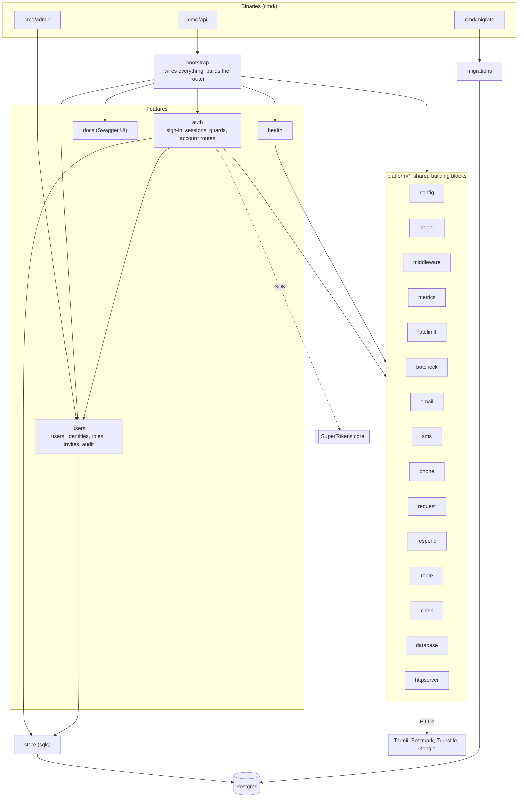
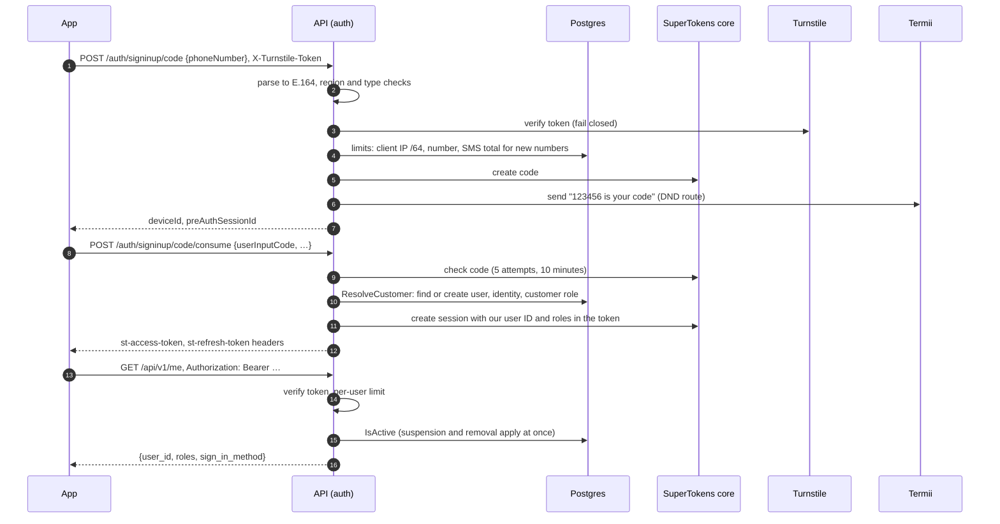

# Architecture

How the code is organised, how a request travels through it, and where each feature lives. Each package's own doc comment (`go doc ./internal/<pkg>`) says what it owns; `make lint` fails if one is missing.

## How the pieces fit

Arrows point from a package to what it uses. Feature packages never import `bootstrap`, and `platform/*` never imports a feature package.



## Request flow

Every request passes through one middleware chain, set in `internal/bootstrap/router.go`, in this order:

1. **RequestID**: assigns an ID, adds it to the logger and the `X-Request-ID` response header
2. **Log**: one structured line per request with method, matched route, status, bytes, duration and, once a session is verified, `user_id`
3. **Metrics**: request count and latency by method, route and status
4. **Routes**: records the matched pattern so logs and metrics stay low-cardinality
5. **Recover**: turns panics into a JSON 500, or aborts the connection if the response already started
6. **SecureHeaders**: nosniff, frame denial, strict CSP, no-store, and HSTS in production
7. **CORS**: credentialed CORS for listed origins, plus CSRF protection via `http.CrossOriginProtection`
8. **RateLimit**: per client IP (IPv6 by /64) on every route but the health probes
9. **MaxBytes**: 1 MiB body limit
10. **Timeout**: request context deadline

The SuperTokens middleware sits inside the chain and serves `/auth/*`. Everything else falls through to the router, where `/api/v1` routes are guarded by `auth.RequireSession` or `auth.RequireAdmin`.

Unknown paths return a JSON 404. Known paths with the wrong method return a JSON 405 with `Allow`.

## Feature map

Where each feature lives. Start from the entry point and follow the calls.

| Feature | Entry point | Core logic | Storage and outside services |
| --- | --- | --- | --- |
| Send a sign-in code | `POST /auth/signinup/code` → `auth/override.go` `create` | `canonicalise` (`platform/phone`, `platform/email`), `checkHuman` (`auth/botcheck.go`, `platform/botcheck`), `allowSend` (`auth/limiter.go`) | `sign_in_attempts`; SuperTokens core; `auth/delivery.go` → `platform/sms` (Termii) or `platform/email` (Postmark) |
| Resend a code | `POST /auth/signinup/code/resend` → `auth/override.go` `resend` | `allowSend` | as above |
| Sign in with the code | `POST /auth/signinup/code/consume` | `auth/passwordless.go` `overridePasswordlessFunctions` → `users.ResolveCustomer`; `auth/session.go` puts our user ID and roles in the token | `users`, `user_identities`, `user_roles`; core |
| Guard a route | `auth.RequireSession`, `RequireRole`, `RequirePermission` (`auth/middleware.go`) | per-user limit, `users.IsActive` on every request | `users`, `user_identities` |
| Who am I | `GET /api/v1/me` (`auth/me.go`) | `auth.FromContext` | none (from the token) |
| Add an email or phone | `POST /api/v1/me/identities`, `…/verify` (`auth/identities.go`) | `checkHuman`, `allowSend`, `sendLinkCode`; then `users.LinkIdentity` | `user_identities`; core; Termii or Postmark |
| Remove a sign-in method | `DELETE /api/v1/me/identities/{id}` | `users.RemoveIdentity`, which revokes its sessions and deletes its core user first | `user_identities`; core |
| Delete my account / a user | `DELETE /api/v1/me`, `DELETE /api/v1/admin/users/{id}` (`auth/account.go`) | `auth.DeleteAccount` → `users.DeleteUser` | everything for that user (cascade); core; `admin_audit_log` |
| Admin Google sign-in | `GET /auth/authorisationurl`, `POST /auth/signinup` on `ADMIN_API_HOST` (`auth/admin_signin.go`) | `validateAdminClaims`, `users.AdminEligible`, `users.ResolveAdmin` | `admin_invites`, `user_identities` (`oidc`); Google; core |
| Admin routes | `/api/v1/admin/*` (`auth/admin.go`) behind `auth.RequireAdmin` | invites, suspend and reactivate, delete; each writes the audit log | `admin_invites`, `users`, `admin_audit_log` |
| Errors on `/auth` | `auth/apierror.go`, `auth/errorwriter.go` | client mistakes become 4xx; every error body carries `request_id` | none |
| Rate limits | `middleware.RateLimit` (IP), `auth.RequireSession` (user), `allowSend` (code sends) | `platform/ratelimit` (in memory), `auth.Limiter` (Postgres, HMAC keys) | `sign_in_attempts` |
| Health | `GET /livez`, `GET /readyz` (`health`) | shared database ping | Postgres |
| Metrics | `METRICS_ADDR/metrics` (`platform/metrics`, `platform/httpserver/background.go`) | recorders in middleware, auth, delivery and the core client | none |
| Migrations | `cmd/migrate` (Fly `release_command`) | `migrations.Up` with an advisory lock | Postgres |
| First admin | `cmd/admin invite <email>` | `users.CreateAdminInvite` | `admin_invites` |

## Phone sign-in, step by step



Email sign-in is the same flow without the SMS total, with Postmark in place of Termii.

## Admin sign-in, step by step

```mermaid
sequenceDiagram
    autonumber
    participant Admin as Admin app
    participant API as API on ADMIN_API_HOST
    participant Google
    participant DB as Postgres
    participant Core as SuperTokens core

    Admin->>API: GET /auth/authorisationurl?thirdPartyId=staff
    API-->>Admin: Google URL (PKCE, prompt=select_account, hd)
    Admin->>Google: staff signs in with 2-step verification
    Google-->>Admin: redirect with code
    Admin->>API: POST /auth/signinup {code, pkceCodeVerifier}
    API->>Google: exchange code, verify ID token
    API->>API: issuer, audience, verified email on ADMIN_EMAIL_DOMAIN, hd
    API->>DB: AdminEligible, then ResolveAdmin (accept invite on first sign-in)
    API->>Core: session with amr=oidc, roles=[admin], auth_time
    API-->>Admin: session
    Admin->>API: /api/v1/admin/... (RequireAdmin)
    API->>DB: re-check active admin on every request; refuse after ADMIN_SESSION_MAX_AGE
```

## Adding an endpoint

Create a package under `internal/`, expose a `Register(mux route.Mux)` function, and call it from `registerAPI` in `internal/bootstrap/router.go`. Routes registered there are served under `/api/v1`.

```go
func (h *Handler) Register(mux route.Mux) {
	mux.Handle("POST /things", http.HandlerFunc(h.create))
}
```

Describe every new route in `api/openapi.yaml`, with its request body, responses and the security it needs. `TestOpenAPIMatchesRoutes` fails if a served route is missing from the spec or the spec lists one that isn't served.

Handlers should:

- decode bodies with `request.Decode`, and answer a `*request.Error` with its `Status` and `Message`
- pass `r.Context()` to every database and network call
- send results with `respond.JSON` and failures with `respond.Error` or `respond.ServerError`

Phone numbers go through the shared validator in `deps.Phone`, never straight into storage:

```go
n, err := h.phones.Parse(body.Phone)
if err != nil {
	respond.Error(w, r, http.StatusUnprocessableEntity, phone.Message(err))
	return
}
store(n.E164())
```

`Parse` accepts local or international input, including full-width digits and common separators, and rejects letters, extensions, unknown country codes, impossible lengths and unassigned ranges. By default only mobile-capable numbers pass. `Number` masks itself in `fmt` and slog; `E164()` is the only way to the raw value.

`respond.ServerError` logs the cause and sends a generic message. Deadlines become 503 and client disconnects 499.

## Packages

| Package | Responsibility |
| --- | --- |
| `platform/config` | Load and validate environment variables; `Secret` keeps values out of logs |
| `platform/logger` | slog setup (JSON in production) and credential redaction |
| `platform/httpserver` | Server lifecycle and graceful shutdown |
| `platform/middleware` | The chain above |
| `platform/metrics` | Prometheus metrics in a private registry, served on `METRICS_ADDR` |
| `auth` | SuperTokens passwordless and sessions, code delivery, rate limiting. See [auth](auth.md) |
| `users` | Users, identities, roles, admin invites and the audit log |
| `store` | sqlc-generated queries |
| `platform/email` | Email `Sender` interface, address normalisation, Postmark and log providers |
| `platform/sms` | SMS `Sender` interface, Termii and log providers |
| `platform/phone` | Phone number parsing, policy and masking |
| `platform/request` | Strict JSON decoding |
| `platform/respond` | JSON responses and error mapping |
| `platform/requestid` | Request ID generation and context storage |
| `platform/route` | Path prefixing for route groups |
| `platform/clock` | Injectable time source for tests |
| `platform/ratelimit` | In-memory per-key request limits (GCRA) for the per-IP and per-user limits |
| `platform/botcheck` | Cloudflare Turnstile verification before codes are sent |
| `platform/database` | pgx pool with startup ping |
| `health` | `/livez` and `/readyz` |
| `bootstrap` | Builds dependencies, the router and the middleware chain; runs the server |
| `migrations` | The SQL migrations, embedded, and `Up` for `cmd/migrate` |
| `cmd/api`, `cmd/admin`, `cmd/migrate` | The API server, the admin invite tool, and the migration runner |
| `docs` | Serves `api/openapi.yaml` and Swagger UI when `API_DOCS_ENABLED`, with its own Content-Security-Policy |
